<!-- Generated art lives in assets/ — rebuild with: python3 scripts/generate.py -->

  

  &nbsp;
  &nbsp;
  

  

  

<b>📂 CLASSIFIED: operating directives</b> (clearance level: curious)

 

| # | Directive |
|:-:|:--|
| 01 | If I do it twice, an agent does it the third time. |
| 02 | Always use the best model. Benchmarks are suggestions; vibes are data. |
| 03 | Prototype tonight. Make it good tomorrow. Make it *over the top* by Friday. |
| 04 | There is no such thing as too many terminals. |
| 05 | Every spreadsheet is an app that hasn't been built yet. |
| 06 | Agents don't sleep. I'm working on fixing that for myself too. |
| 07 | "It works on my machine" is a perfectly good deployment strategy if you own enough machines. |

  

